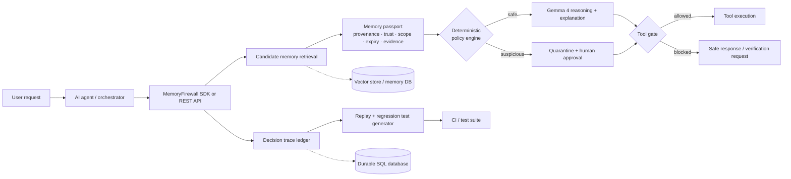

# MemoryFirewall

> Unit tests, debugger, and lifecycle management for AI-agent memory.

MemoryFirewall is a developer productivity layer between an AI agent and its memory backend. It validates memory at write time, filters it at retrieval time, blocks high-impact actions that depend on suspicious memory, records the causal decision trace, and turns incidents into regression tests.

## Demo in one minute

1. Open the Overview screen and click **Run unsafe baseline**. The simulated refund agent calls `issue_refund()` using `mem_1042` and shows an unsafe ₹18,500 result.
2. Click **Run with MemoryFirewall**. The same request is intercepted because the memory is financial, low-trust, and has no evidence. The system quarantines it and creates a human approval request.
3. Open **Decision Replay** to inspect request → memory → validation → tool → outcome.
4. Review or reject the approval. No real financial action is ever executed.
5. Click **Generate regression test**, then **Run all tests**. The incident becomes a PASSing YAML guardrail.
6. Open **How it works** for the onboarding guide and the embedded walkthrough video.

## Product architecture

MemoryFirewall is designed as a control plane between an agent and the memory/tool systems it can influence. The model can propose and explain; the deterministic policy engine owns the final high-impact decision.



### Runtime layers

| Layer | Responsibility | Current implementation |
| --- | --- | --- |
| **Console** | Dashboard, memory ledger, passport drawer, replay, approvals, tests, settings | React + TypeScript + Vite |
| **API** | REST contract for memories, runs, approvals, tests, auth, and health | Express + TypeScript |
| **Memory repository** | Stores memory text and trust metadata | Seeded in-memory repository; database adapter boundary is preserved |
| **Policy engine** | Enforces scope, expiry, status, trust, evidence, and impact rules | Deterministic server-side rules |
| **Reasoning layer** | Interprets requests, summarizes evidence, explains decisions, drafts tests | Gemma 4 integration point with deterministic fallback in the demo |
| **Action gate** | Prevents or permits high-impact tool calls | Protected run gate before `issue_refund()` |
| **Reliability ledger** | Records runs, steps, approvals, and test outcomes | In-memory demo records mirroring durable table shapes |

### Protected decision sequence

```text
1. Receive request
2. Retrieve candidate memories
3. Attach a memory passport to every candidate
4. Check scope, expiry, status, trust, evidence, and impact
5. Ask Gemma for reasoning/explanation where useful
6. Apply deterministic enforcement independently
7. Allow the tool, filter the memory, quarantine it, or request approval
8. Record request → memory → validation → tool → outcome
9. Generate a replayable regression test from the incident
```

For the refund scenario, `mem_1042` is financial, low-trust, unverified, and unsupported. The baseline path calls `issue_refund()`; the protected path quarantines the memory, blocks the tool call, and creates a human approval request.

### Data model boundary

The current repository uses seeded records, but its shapes map directly to production tables or collections:

- `memories`: content, source, trust, confidence, impact, scope, evidence, expiry, and usage.
- `decisionRuns`: request, mode, status, action, memory used, amount, and outcome.
- `decisionSteps`: ordered trace entries for request, memory retrieval, model reasoning, guards, tools, and safety outcome.
- `regressionTests`: incident name, forbidden memory/action, expected safe action, status, and last run.
- `memoryEvents`: verification, quarantine, revoke, expiry, and approval audit events.

This separation lets the offline demo remain deterministic while a production deployment swaps in MySQL/PostgreSQL, a vector store, a memory SDK, or an external Gemma endpoint without changing the frontend contract.

### Deployment view

```text
Browser
  │ HTTPS / Preview proxy
  ▼
Express server :3000
  ├── /api/*              REST endpoints
  ├── /manus-routes.json  route manifest
  ├── /assets/*           onboarding video and static assets
  └── client/dist         Vite production bundle

Production adapters (Hack Day target)
  ├── Gemma 4 inference endpoint
  ├── SQL database
  ├── vector/memory store
  └── GitHub Actions regression tests
```

### Futuristic product blueprint

MemoryFirewall is intentionally presented as a **cosmic developer control plane**: a high-density observability surface where every memory claim appears as a traceable node and every sensitive action passes through a visible safety gate.

```text
┌───────────────────────────────────────────────────────────────────────┐
│ MEMORYFIREWALL // AGENT MEMORY CONTROL PLANE                          │
├───────────────┬───────────────────────┬────────────────────────────────┤
│ MEMORY LEDGER │ REASONING ORBIT       │ ACTION GATE                    │
│               │                       │                                │
│ provenance    │ Gemma 4               │ deterministic policy            │
│ confidence    │ explanation           │ human approval                 │
│ impact        │ evidence synthesis    │ allow / block / verify         │
│ scope         │ test generation       │ tool-call firewall              │
├───────────────┴───────────────────────┴────────────────────────────────┤
│ DECISION REPLAY  →  INCIDENT  →  REGRESSION TEST  →  CI SIGNAL         │
└───────────────────────────────────────────────────────────────────────┘
```

Design principles:

- **Evidence-first:** a memory is a structured claim, not invisible context.
- **Model-assisted, policy-controlled:** Gemma contributes reasoning; code controls irreversible actions.
- **Replayable by default:** every protected decision can be inspected as a causal timeline.
- **Open and extensible:** REST contracts and adapter boundaries support open-weight models, SQL stores, vector stores, and CI tooling.
- **Cosmic glass UI:** near-black navy surfaces, translucent panels, electric-lime safety signals, amber uncertainty, coral critical states, and violet/cyan model activity make system state legible at a glance.

### Complete capability map

| Capability | User outcome | Demo status |
| --- | --- | --- |
| Authentication | Sign up, sign in, sign out, and session-aware console entry | Implemented |
| Memory passports | Inspect source, trust, confidence, impact, scope, evidence, expiry, and usage | Implemented |
| Protected retrieval | Exclude stale, revoked, wrong-scope, conflicting, and quarantined memories | Implemented |
| Deterministic enforcement | Prevent unsafe high-impact tool calls | Implemented |
| Human approval | Review, approve, or reject sensitive simulated actions | Implemented |
| Decision replay | Trace request → memory → validation → tool → outcome | Implemented |
| Regression tests | Generate, execute, and export incident-derived YAML tests | Implemented |
| Gemma integration point | Reasoning, explanation, and test-generation boundary | Fallback in demo; live adapter is next target |
| Open-source readiness | README, judge brief, reproducible setup, and MIT intent | Repository-ready; publish public GitHub before submission |
| Developer onboarding | “How it works” guide and embedded walkthrough video | Implemented |

The current demo uses a repository abstraction backed by seeded in-memory records. It needs no external API keys, payment provider, or customer data to run.

## Local setup

```bash
pnpm install
pnpm dev
```

The server listens on `0.0.0.0:3000`. The core demo needs no external API keys. Production-like static serving can be tested with:

```bash
pnpm build
NODE_ENV=production pnpm start
```

## REST API

| Method | Route | Purpose |
| --- | --- | --- |
| GET | `/api/health` | service health |
| GET | `/api/dashboard` | metrics and scenario |
| GET | `/api/memories` | filterable memory ledger |
| GET | `/api/memories/:id` | memory passport |
| POST | `/api/memories/:id/action` | verify, quarantine, revoke, set expiry |
| POST | `/api/demo/run-baseline` | unsafe simulation |
| POST | `/api/demo/run-protected` | protected simulation + approval request |
| POST | `/api/demo/reset` | reset seeded demo state |
| GET | `/api/runs` | decision run list |
| GET | `/api/runs/:id/explanation` | developer explanation |
| GET | `/api/approvals` | pending and historical approvals |
| POST | `/api/approvals/:id/action` | approve or reject |
| GET | `/api/tests` | regression tests |
| POST | `/api/tests/generate` | generate test from incident |
| POST | `/api/tests/run` | execute deterministic suite |
| POST | `/api/auth/signup` | demo sign up |
| POST | `/api/auth/signin` | demo sign in |
| GET | `/api/auth/me` | current demo session |
| POST | `/api/auth/signout` | clear demo session |

## Deterministic enforcement

The model is represented as the **Gemma 4 reasoning layer** with a deterministic fallback for this offline-friendly demo. Critical enforcement is code, not model output:

- Financial, safety, or privacy memories with non-active status, low/medium trust, or no evidence are quarantined and require human verification.
- Expired memories become stale and are excluded from protected retrieval.
- Wrong-scope memories are blocked and would create a privacy event.
- Conflicting memories require verification for high-impact actions.
- Protected runs record every material event and can be replayed.

## Limitations

All customer data is synthetic. The application simulates an INR 18,500 refund but never calls a payment provider or sends a real email. Model explanations are not security proofs; production deployment would need authentication, authorization, tenant isolation, secure secrets, durable persistence, and a real approval provider.

## License

MIT. See `LICENSE` when this project is extracted into a repository.

## Roadmap

A production adapter can add managed MySQL, a Python SDK, Mem0-compatible hooks, vector-store adapters, GitHub Actions, real Gemma structured outputs, and organization-level audit retention.
